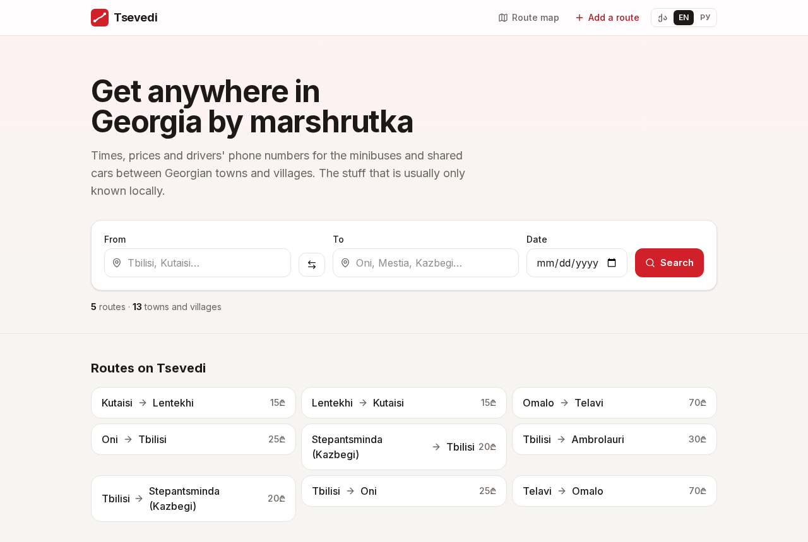
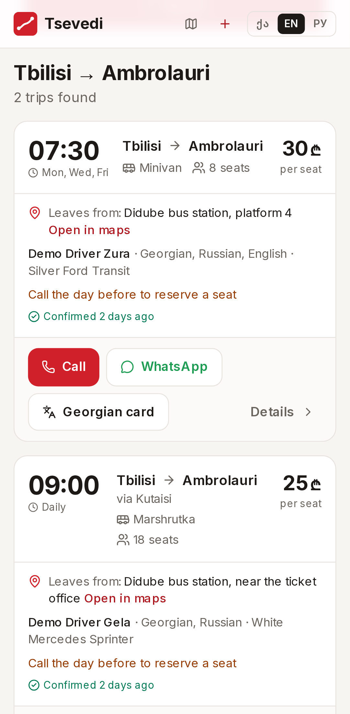
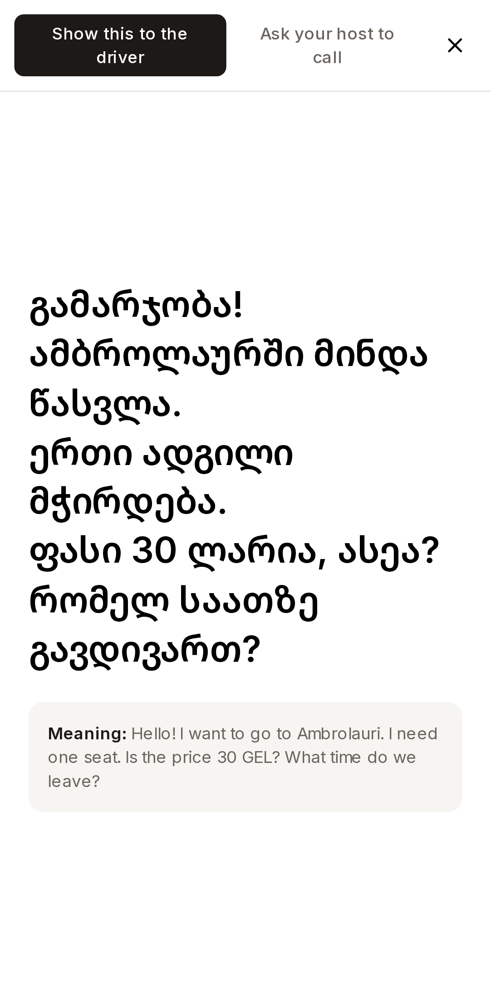
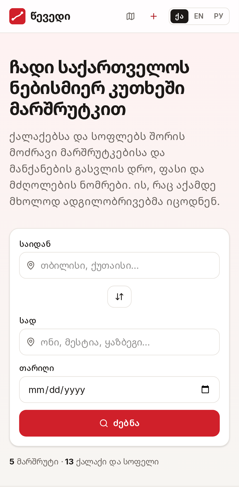

<div align="center">


# Tsevedi · წევედი

**Marshrutkas and shared rides between Georgian towns and villages: departure times, prices, where they leave from and the driver's phone number. In Georgian, English and Russian.**

[](https://github.com/nikakek/tsevedi/actions/workflows/ci.yml)


</div>

<p align="center">
  
</p>

<p align="center">
  
  
  
</p>

<sub>Screenshots use demo listings.</sub>

## Why

Outside Tbilisi, Batumi and Kutaisi, public transport in Georgia runs on local knowledge. The marshrutka to a village
in Racha, Tusheti or Svaneti often leaves once a day, there's no timetable online, and the only way to get a seat is
to call the driver the day before. You need to know someone who has the driver's number.

Tsevedi puts that knowledge in one place. The name is the dialect form of წავედით, "let's go", as it's said in the
villages.

## Features

- **Search in any script.** `ყაზბეგი`, `Казбеги`, `Kazbegi` and `kazbegy` all find Stepantsminda. Transliteration
  plus fuzzy matching with typo tolerance ([`translit.ts`](src/lib/translit.ts), [`place-search.ts`](src/lib/place-search.ts)).
- **Stops along the way.** A Tbilisi → Ambrolauri → Oni marshrutka shows up when searching Tbilisi → Ambrolauri or
  Ambrolauri → Oni, and in reverse when the driver returns the same day.
- **Help for people who don't speak Georgian.** WhatsApp messages pre-written in Georgian, plus a full-screen card to
  show the driver or to hand to hostel staff ("please call this driver for me"), with correct Georgian case endings
  for every place name ([`phrases.ts`](src/lib/phrases.ts)).
- **Information you can trust.** Every submission is checked by phone before it's published. Listings show when they
  were last confirmed, either by the admin or by a traveller's "I took this ride" report. Stale listings are flagged
  and eventually hidden.
- **Date-aware.** Weekday and seasonal schedules (e.g. Tusheti jeeps, June to September only).
- **National route map** of every listed route (Leaflet + OpenStreetMap).
- **Trilingual and SEO-ready.** `/ka`, `/en`, `/ru` with browser language detection, hreflang alternates, a sitemap
  of every route page and Open Graph images.
- **Moderation dashboard** with tap-to-call verification, a freshness queue, an editor, and problem and ride-report
  moderation.
- **Public REST API** for the upcoming React Native app ([docs/API.md](docs/API.md)).
- **Free, no commission.** Drivers keep 100% of the fare.

## Tech stack

| Area     | Choice                                                                                                  |
| -------- | ------------------------------------------------------------------------------------------------------- |
| App      | [Next.js 16](https://nextjs.org) App Router with Cache Components (partial prerendering, `"use cache"`) |
| Language | TypeScript (strict)                                                                                     |
| Data     | PostgreSQL 17, [Prisma 7](https://www.prisma.io) with the `pg` driver adapter                           |
| UI       | React 19, Tailwind CSS 4, lucide icons, Inter + Noto Sans Georgian                                      |
| Forms    | Server Actions + [Zod 4](https://zod.dev) schemas shared with the REST API                              |
| Testing  | Vitest (unit), Playwright (end-to-end on desktop and mobile viewports)                                  |
| CI       | GitHub Actions: lint, type check, formatting, unit tests, and e2e against a real Postgres               |

## Architecture

```
src/
├── app/
│   ├── [locale]/            Public pages (ka/en/ru): home, routes/[from]/[to], listings/[id], places/[slug], add, map
│   ├── admin/               Moderation dashboard (separate root layout, not indexed)
│   ├── api/v1/              Public JSON API
│   ├── sitemap.ts, robots.ts
├── components/              UI components (server by default, client where interactive)
├── i18n/                    Locale config, negotiation, typed dictionaries
├── lib/                     Pure, framework-free logic with unit tests
├── server/                  Database access: cached queries, mutations, admin, auth, rate limiting
└── proxy.ts                 Redirects / to the visitor's language
prisma/
├── schema.prisma            Place, Driver, Listing, RouteStop, RideReport, ProblemReport
├── data/places.ts           86 towns, villages, resorts and border points in three languages
└── seed.ts                  Seeds places only. Listings always come from real submissions.
e2e/                         Playwright tests
```

Some design decisions:

- **A listing is an ordered list of stops**, so one record answers searches between any two of its stops in either
  direction. Matching is a pure function ([`route-matching.ts`](src/lib/route-matching.ts)) run over a cached list of
  approved listings. At hundreds of rows that is simpler and faster than SQL; the function can move into a query if
  the dataset grows by orders of magnitude.
- **Cache Components.** Public reads are `"use cache"` with tags. Admin actions call `updateTag`, so an approved
  listing appears instantly, while pages are otherwise served from the static shell.
- **No dictionary drift.** `ka.ts` and `ru.ts` are typed against `en.ts`, so a missing translation fails the build.
- **Spam defences without accounts.** Honeypot fields, per-IP rate limits that count only valid submissions, submit
  buttons that wait for hydration, and manual approval of every listing.

## Getting started

Requirements: Node.js 22+, Docker (for the local database).

```bash
git clone https://github.com/nikakek/tsevedi.git
cd tsevedi
cp .env.example .env          # set ADMIN_PASSWORD and SESSION_SECRET
npm install
npm run db:up                 # start PostgreSQL in Docker
npm run db:migrate            # apply migrations
npm run db:seed               # load places
npm run dev
```

Open http://localhost:3000. The moderation dashboard is at http://localhost:3000/admin.

### Scripts

| Command                                 | What it does                                      |
| --------------------------------------- | ------------------------------------------------- |
| `npm run dev`                           | Development server                                |
| `npm run build` / `npm start`           | Production build and server (needs the database)  |
| `npm test`                              | Unit tests (Vitest)                               |
| `npm run test:e2e`                      | End-to-end tests (Playwright; needs the database) |
| `npm run lint` / `typecheck` / `format` | ESLint, TypeScript, Prettier                      |
| `npm run db:migrate` / `db:seed`        | Create/apply migrations, seed places              |
| `npm run db:studio`                     | Browse the database in Prisma Studio              |

## Deployment

Any Node.js host with PostgreSQL works. For example, [Vercel](https://vercel.com) with
[Neon](https://neon.tech): set `DATABASE_URL`, `ADMIN_PASSWORD`, `SESSION_SECRET` and `NEXT_PUBLIC_SITE_URL`, then
run `npm run db:deploy && npm run db:seed` once against the production database. The build prerenders pages, so the
database must be reachable at build time.

The rate limiter is in memory, which is fine for one instance. On multiple instances, replace it with Redis/Upstash
([`rate-limit.ts`](src/server/rate-limit.ts)).

## Roadmap

- [ ] React Native app on top of the REST API
- [ ] More villages and border crossings
- [ ] "Notify me when a driver is added for this route"
- [ ] Guesthouse recommendations and transfer affiliate links for routes with no marshrutka (to cover hosting costs)

## Contributing

Corrections and new places are very welcome. See [CONTRIBUTING.md](CONTRIBUTING.md). To add a route, use
**Add a route** on the site; every submission is checked by phone before it goes live.

## License

[MIT](LICENSE) © Nika Kekenadze
